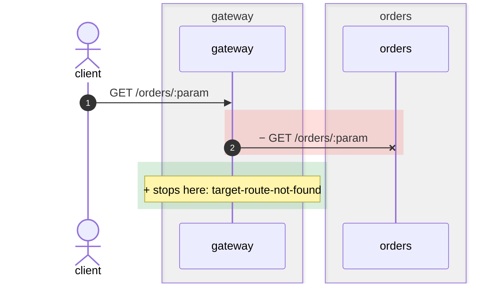
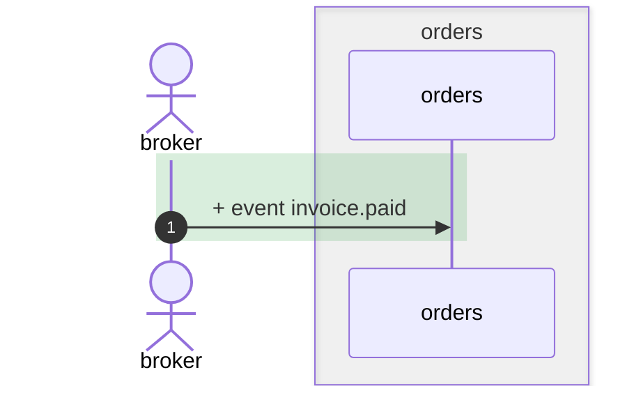
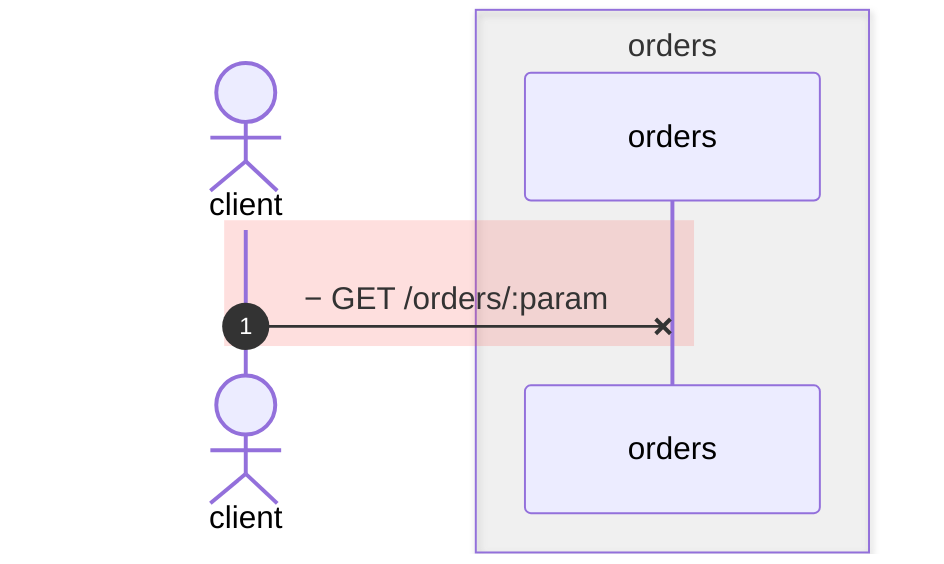

## flowatlas diff

`prod` → `drop-lookup`

The base side is what prod runs, pinned in `flowatlas.deployed.json`.

| service | deployed | pinned by | head |
| --- | --- | --- | --- |
| `billing` | `v1` e93604ab | file | as deployed |
| `gateway` | `v1` 5cce0519 | file | as deployed |
| `orders` | `v1` f36068c5 | file | `drop-lookup` e6a023fe |

| service | base | head | read |
| --- | --- | --- | --- |
| `billing` | e93604ab | e93604ab | base from cache |
| `gateway` | 5cce0519 | 5cce0519 | base from cache |
| `orders` | f36068c5 | e6a023fe | base from cache |

## Impact

| changed | service | reachable from |
| --- | --- | --- |
| `AppModule` | orders | no entry points and nothing reaches it — see `flowatlas dead` |
| `orders` | orders | no entry points and nothing reaches it — see `flowatlas dead` |
| `GET /orders/:param` | orders | 1 http entry (gateway); as of base — this node is gone in head |
| `OrdersController.findOne` | orders | 2 http entries (gateway, orders); as of base — this node is gone in head |

<details><summary>GET /orders/:param — ways in</summary>

| entry | service | kind | confidence |
| --- | --- | --- | --- |
| `entry:gateway:http:GET:/orders/:param` | gateway | http | static |

</details>

<details><summary>OrdersController.findOne — ways in</summary>

| entry | service | kind | confidence |
| --- | --- | --- | --- |
| `entry:orders:http:GET:/orders/:param` | orders | http | static |
| `entry:gateway:http:GET:/orders/:param` | gateway | http | static |

</details>

## Changed flows

<details open><summary><code>GET /orders/:param</code> (gateway) — 1 step added, 1 removed; crosses gateway → orders</summary>



```diff
  client → gateway GET /orders/:param  · gateway/src/orders/gateway.controller.ts:17
- gateway → orders GET /orders/:param  · gateway/src/clients/orders.client.ts:21
+ gateway stops here: target-route-not-found  · gateway/src/clients/orders.client.ts:21
```

</details>

<details><summary><code>event invoice.paid</code> (orders) — added, a way in the base did not have: 1 step</summary>



```diff
+ broker → orders event invoice.paid  · orders/src/orders/invoice-paid.consumer.ts:13
```

</details>

<details><summary><code>GET /orders/:param</code> (orders) — removed, as of base: 1 step gone</summary>



```diff
- client → orders GET /orders/:param  · orders/src/orders/orders.controller.ts:17
```

</details>

## Contract changes

0 new, 0 fixed, 2 already there, 0 excused

This revision introduces no new contract finding.

### Already there

Not introduced by this revision, and not counted against it.

| severity | kind | between | direction | field | what |
| --- | --- | --- | --- | --- | --- |
| info | extra_field | orders → billing | payload | customerId | sender orders sends `customerId: string`; receiver billing declares no such field |
| error | missing_required | orders → billing | payload | customerRef | receiver billing requires `customerRef: string`; sender orders does not send it |

## Rules

0 new, 0 fixed, 1 already there, 0 excused

This revision breaks no architecture rule it did not already break.

### Already there

Not introduced by this revision, and not counted against it.

| rule | severity | what crossed | where | confidence |
| --- | --- | --- | --- | --- |
| `billing-reads-no-order-events` | error | billing PlacedConsumer.onPlaced consumes channel order.placed | `billing src/invoices/placed.consumer.ts:9` | static |

## Calls that stopped joining

| caller | joined | what happened |
| --- | --- | --- |
| `consumer:orders#src/orders/invoice-paid.consumer.ts:InvoicePaidConsumer.onPaid` | `channel:invoice.paid` | a new handler of what nothing publishes |
| `http_out:gateway#src/clients/orders.client.ts:21:12` | `entry:orders:http:GET:/orders/:param` | its target is gone; now `target-route-not-found` |

## Gaps and findings

1 new, 0 gone

| kind | reason | where | in |
| --- | --- | --- | --- |
| gap | `target-route-not-found` | `gateway src/clients/orders.client.ts:21` | `http_out:gateway#src/clients/orders.client.ts:21:12` |

## Types

Added: `type:orders#InvoicePaidEvent`

## Graph

|  | added | removed | changed | moved |
| --- | --- | --- | --- | --- |
| nodes | 5 | 2 | 2 | 0 |
| edges | 3 | 3 | 0 | — |
| types | 1 | 0 | 0 | — |

---

unresolved: 3 rows over 3 sites in head (+1 rows, +1 sites against base)

base <ms> · head <ms> · diff <ms> · <ms> total

