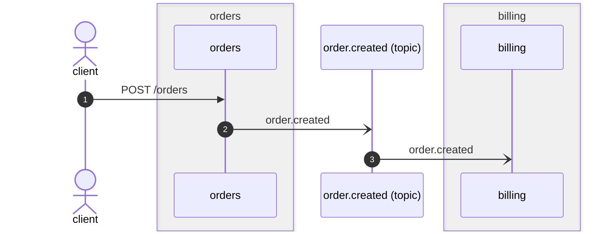

# Orders, as the pages describe them

Written by `flowatlas docs --write` against this revision. The head revision
changes both flows below without touching this page, so `flowatlas diff`
names both blocks under "Docs this branch makes stale".

## Placing an order

<!-- flowatlas:flow id="POST /orders" service="orders" view="sequence" -->

<!-- /flowatlas:flow fingerprint="646aba4f"
["enters","caller","orders","POST /orders","",["type:orders#CreateOrderDto"],"type:orders#OrderDto"]
["emits","orders","channel:order.created","order.created","",["type:orders#OrderCreatedEvent"]]
["consumes","channel:order.created","billing","order.created","",[],"",["type:billing#OrderCreatedEvent"]]
-->

## Tracking a shipment

<!-- flowatlas:flow id="GET /shipments/:id" view="steps" -->
```text
@  GET /shipments/:param        orders/src/shipments/shipments.controller.ts:16
  -> ShipmentsController.track  orders/src/shipments/shipments.controller.ts:16
    -> ShipmentsService.track   orders/src/shipments/shipments.service.ts:11
unresolved on this path: 0
```
<!-- /flowatlas:flow fingerprint="f4f04d81"
["enters","caller","orders","GET /shipments/:param","",["string"],"type:orders#ShipmentDto"]
-->

## Checking out

Billing takes a checkout in <!-- flowatlas:ref id="billing#src/invoices/checkout.consumer.ts:CheckoutConsumer.onCheckedOut" -->`CheckoutConsumer.onCheckedOut`, which neither revision changes.
