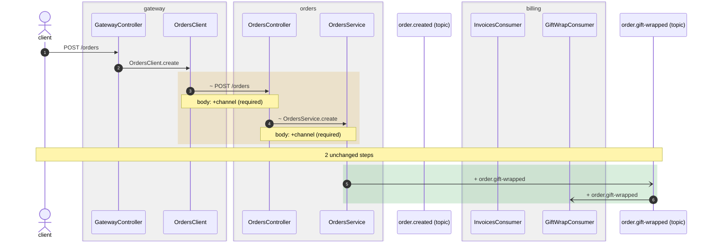

## flowatlas diff

`HEAD~1` → `working tree`

| service | base | head | read |
| --- | --- | --- | --- |
| `billing` | 392089da | working tree | base from cache |
| `gateway` | working tree | working tree | unchanged |
| `orders` | 08ad86ef | working tree | base from cache |

## Warnings

- **ref-not-found** — gateway: ref HEAD~1 not found, so it was read as it stands and assumed unchanged Pass --service, or use a ref that exists in every repository.

## Impact

| changed | service | reachable from |
| --- | --- | --- |
| `InvoicesConsumer.onOrderCreated` | billing | 2 http entries (gateway, orders), 1 consumer (billing) |
| `ShipmentsService.track` | orders | 1 http entry (orders) |
| `billing` | billing | no entry points and nothing reaches it — see `flowatlas dead` |
| `GET /shipments/:param` | orders | 1 http entry (gateway); as of base — this node is gone in head |
| `OrdersService.legacy` | orders | no entry points and nothing reaches it — see `flowatlas dead` (as of base) |

<details><summary>InvoicesConsumer.onOrderCreated — ways in</summary>

| entry | service | kind | confidence |
| --- | --- | --- | --- |
| `entry:billing:event:order.created` | billing | event | static |
| `entry:orders:http:POST:/orders` | orders | http | static |
| `entry:gateway:http:POST:/orders` | gateway | http | static |

</details>

<details><summary>ShipmentsService.track — ways in</summary>

| entry | service | kind | confidence |
| --- | --- | --- | --- |
| `entry:orders:http:GET:/shipments/:param/status` | orders | http | static |

</details>

<details><summary>GET /shipments/:param — ways in</summary>

| entry | service | kind | confidence |
| --- | --- | --- | --- |
| `entry:gateway:http:GET:/orders/:param/shipment` | gateway | http | static |

</details>

## Changed flows

<details open><summary><code>POST /orders</code> (gateway) — 2 steps added, 2 changed; crosses gateway → orders → billing</summary>



```diff
  client → GatewayController POST /orders  · gateway/src/orders/gateway.controller.ts:11
  GatewayController → OrdersClient OrdersClient.create  · gateway/src/orders/gateway.controller.ts:13
~ OrdersClient → OrdersController POST /orders (body: +channel (required))  · gateway/src/clients/orders.client.ts:21
~ OrdersController → OrdersService OrdersService.create (body: +channel (required))  · orders/src/orders/orders.controller.ts:25
  … 2 unchanged steps
+ OrdersService → order.gift-wrapped (topic) order.gift-wrapped  · orders/src/orders/orders.service.ts:23
+ order.gift-wrapped (topic) → GiftWrapConsumer order.gift-wrapped  · billing/src/invoices/gift-wrap.consumer.ts:15
```

</details>

… 5 more changed flows: `GET /orders/:param/shipment`, `POST /orders`, `event order.gift-wrapped`, `GET /shipments/:param`, `GET /shipments/:param/status`; every flow is in <scratch>/project/.flowatlas/diff.json

Ways in whose steps did not change: `event order.created` (billing)

## Contract changes

1 new, 0 fixed, 0 already there, 2 excused

### New

| severity | kind | between | direction | field | what |
| --- | --- | --- | --- | --- | --- |
| error | missing_required | gateway → orders | request | channel | receiver orders requires `channel: string`; sender gateway does not send it |

### Excused

`@ContractIgnore` or `contracts.ignoreEdges` says this drift is deliberate. Never counted, never hidden.

| kind | between | field | by |
| --- | --- | --- | --- |
| extra_field | orders → billing | customerId | `billing#src/invoices/invoices.consumer.ts:InvoicesConsumer.onOrderCreated` |
| missing_required | orders → billing | customerRef | `billing#src/invoices/invoices.consumer.ts:InvoicesConsumer.onOrderCreated` |

## Rules

1 new, 0 fixed, 0 already there, 0 excused

### New

| rule | severity | what crossed | where | confidence |
| --- | --- | --- | --- | --- |
| `billing-stays-out-of-gift-wrapping` | error | billing GiftWrapConsumer.onGiftWrapped consumes channel order.gift-wrapped | `billing src/invoices/gift-wrap.consumer.ts:15` | static |

- `billing-stays-out-of-gift-wrapping`: gift wrapping is fulfilment, which orders does

## Calls that stopped joining

| caller | joined | what happened |
| --- | --- | --- |
| `http_out:gateway#src/clients/orders.client.ts:26:12` | `entry:orders:http:GET:/shipments/:param` | its target is gone; now `target-route-not-found` |

## Gaps and findings

2 new, 0 gone

| kind | reason | where | in |
| --- | --- | --- | --- |
| gap | `target-route-not-found` | `gateway src/clients/orders.client.ts:26` | `http_out:gateway#src/clients/orders.client.ts:26:12` |
| gap | `call-dynamic-receiver` | `orders src/shipments/shipments.service.ts:21` | `orders#src/shipments/shipments.service.ts:ShipmentsService.track` |

## Types

| type | what changed |
| --- | --- |
| `type:orders#CreateOrderDto` | head declares `channel` as `string` and requires it; base did not send it |

Added: `type:billing#GiftWrappedEvent`, `type:orders#OrderGiftWrappedEvent`

## Graph

|  | added | removed | changed | moved |
| --- | --- | --- | --- | --- |
| nodes | 7 | 2 | 3 | 12 |
| edges | 6 | 3 | 1 | — |
| types | 2 | 0 | 1 | — |

---

unresolved: 8 rows over 8 sites in head (+2 rows, +2 sites against base)

base <ms> · head <ms> · diff <ms> · <ms> total

