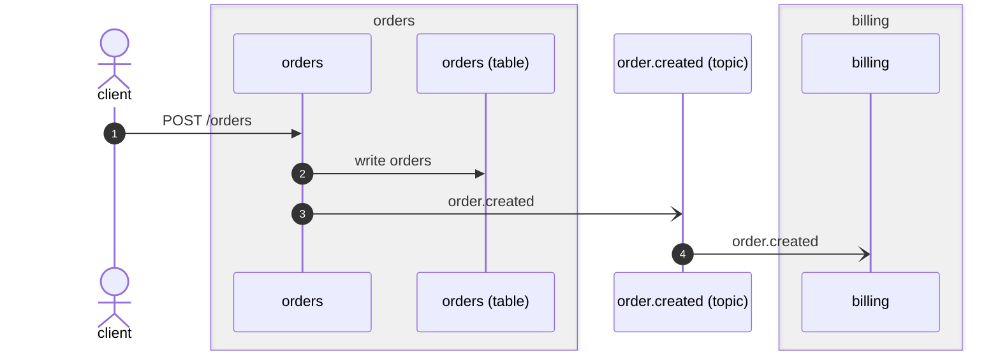
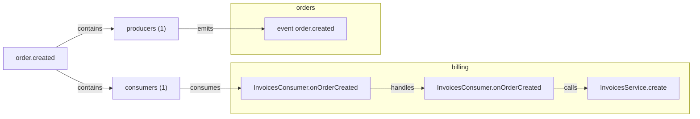

# How the bookshop's orders work

The gateway takes every request from the shop's web front end and asks
`orders` for what it needs; `orders` publishes what happened, and `billing`
listens. The blocks below are generated by `flowatlas docs --write` from the
graph, and `flowatlas docs --check` fails when the flow one describes changes.

## Reading an order

<!-- flowatlas:flow id="GET /orders/:param" service="gateway" view="steps" -->
```text
@  GET /orders/:param                    gateway/src/orders/orders.controller.ts:30
  -> OrdersController.findOne            gateway/src/orders/orders.controller.ts:30
    -> OrdersClient.fetchOne             gateway/src/clients/orders.client.ts:32
      $  ORDERS_URL                      gateway/src/clients/orders.client.ts:33
      ^  GET /orders/:param              gateway/src/clients/orders.client.ts:33
        => orders @  GET /orders/:param  orders/src/orders/orders.controller.ts:25
          -> OrdersController.findOne    orders/src/orders/orders.controller.ts:25
            -> OrdersService.findOne     orders/src/orders/orders.service.ts:25
              [] read orders             orders/src/orders/orders.service.ts:26
                #  orders
unresolved on this path: 0
```
<!-- /flowatlas:flow fingerprint="214311f4"
["enters","caller","gateway","GET /orders/:param","",["string"],"type:axios#AxiosResponse\u003ctype:@fx/contracts#OrderDto\u003e"]
["http_calls","gateway","orders","GET /orders/:param","",[],"type:@fx/contracts#OrderDto",["string"]]
["queries","orders","table:orders/orders","read orders"]
-->

## Creating an order

<!-- flowatlas:flow id="POST /orders" view="sequence" -->

<!-- /flowatlas:flow fingerprint="4bb04c97"
["enters","caller","orders","POST /orders","",["type:@fx/contracts#CreateOrderDto"],"type:@fx/contracts#OrderDto"]
["queries","orders","table:orders/orders","write orders"]
["emits","orders","channel:order.created","order.created","",["type:@fx/contracts#OrderDto"]]
["consumes","channel:order.created","billing","order.created","",[],"",["type:billing#OrderCreatedEvent"]]
-->

What each crossing sends and gets back:

<!-- flowatlas:flow id="POST /orders" view="contract" -->
| # | Step | Sends | Gets back | Handler takes |
|---|---|---|---|---|
| 1 | client → orders `POST /orders` | `CreateOrderDto` | `OrderDto` | — |
| 2 | orders → order.created `order.created` | `OrderDto` | — | — |
| 3 | order.created → billing `order.created` | — | — | `OrderCreatedEvent` |

**Shapes**

- `CreateOrderDto` (object, @fx/contracts): `customerId: string`, `total: Money`
- `OrderDto` (object, @fx/contracts): `id: string`, `customerId: string`, `status: OrderStatus`, `total: Money`
- `OrderCreatedEvent` (object, billing): `id: string`, `customerId: string`, `status: string`, `total: {amount:number;currency:string}`

**Fails with:** no failure was read from the code on this path
<!-- /flowatlas:flow fingerprint="163d7807"
["enters","caller","orders","POST /orders","",["type:@fx/contracts#CreateOrderDto"],"type:@fx/contracts#OrderDto"]
["queries","orders","table:orders/orders","write orders"]
["emits","orders","channel:order.created","order.created","",["type:@fx/contracts#OrderDto"]]
["consumes","channel:order.created","billing","order.created","",[],"",["type:billing#OrderCreatedEvent"]]
-->

Creating an order goes through <!-- flowatlas:ref id="orders#src/orders/orders.service.ts:OrdersService.create" -->`OrdersService.create`,
which saves it and publishes `order.created`.

## Who listens to order.created

<!-- flowatlas:channel id="order.created" view="mermaid" -->

<!-- /flowatlas:channel fingerprint="9c02a67b"
["emits","orders","channel:order.created","order.created","",["type:@fx/contracts#OrderDto"]]
["consumes","channel:order.created","billing","order.created","",[],"",["type:billing#OrderCreatedEvent"]]
-->

## A tour of reading an order

<!-- flowatlas:flow id="entry:gateway:http:GET:/orders/:param" view="tour" -->
1. **GET /orders/:param** · gateway · `src/orders/orders.controller.ts:30` <!-- step key="entry:gateway:http:GET:/orders/:param" -->
   The web front end asks the gateway for one order; nothing in front of it
   checks who is asking.
2. **OrdersController.findOne** · gateway · `src/orders/orders.controller.ts:30` <!-- step key="gateway#src/orders/orders.controller.ts:OrdersController.findOne" -->
   <!-- note -->
3. **OrdersClient.fetchOne** · gateway · `src/clients/orders.client.ts:32` <!-- step key="gateway#src/clients/orders.client.ts:OrdersClient.fetchOne" -->
   <!-- note -->
4. **GET /orders/:param** · gateway · `src/clients/orders.client.ts:33` <!-- step key="http_out:gateway#src/clients/orders.client.ts|GET /orders/:param" -->
   The gateway finds `orders` through `ORDERS_URL`; the same path on both sides.
5. **GET /orders/:param** · orders · `src/orders/orders.controller.ts:25` <!-- step key="entry:orders:http:GET:/orders/:param" -->
   <!-- note -->
6. **OrdersController.findOne** · orders · `src/orders/orders.controller.ts:25` <!-- step key="orders#src/orders/orders.controller.ts:OrdersController.findOne" -->
   <!-- note -->
7. **OrdersService.findOne** · orders · `src/orders/orders.service.ts:25` <!-- step key="orders#src/orders/orders.service.ts:OrdersService.findOne" -->
   <!-- note -->
8. **read orders** · orders · `src/orders/orders.service.ts:26` <!-- step key="db_query:orders#src/orders/orders.service.ts|read orders" -->
   <!-- note -->
9. **orders** · orders <!-- step key="table:orders#orders" -->
   <!-- note -->
<!-- /steps -->
<!-- /flowatlas:flow fingerprint="214311f4"
["enters","caller","gateway","GET /orders/:param","",["string"],"type:axios#AxiosResponse\u003ctype:@fx/contracts#OrderDto\u003e"]
["http_calls","gateway","orders","GET /orders/:param","",[],"type:@fx/contracts#OrderDto",["string"]]
["queries","orders","table:orders/orders","read orders"]
-->

## Exporting orders

This route was removed; the block still names it, so the check says so.

<!-- flowatlas:flow id="GET /orders/:param/export" view="steps" -->
<!-- /flowatlas:flow -->

## Any order route

Two services answer this one, so the block must say which.

<!-- flowatlas:flow id="GET /orders/:param" view="steps" -->
<!-- /flowatlas:flow -->
