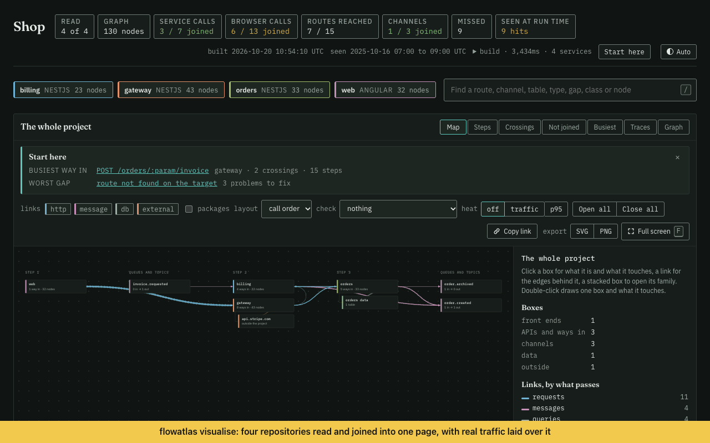

# @flowatlas/cli

**A command-line tool that reads several TypeScript repositories without running
them, joins them into one graph, and answers questions about it.** It knows
NestJS and Angular, React and Next.js, Vue and Nuxt, Svelte and SvelteKit,
Remix, plain pages and the scripts they load, GraphQL, gRPC, Express, Fastify,
Koa and Hono, Medusa, Strapi, Gatsby, tRPC, oRPC and Telegraf; AWS Lambda, API Gateway, Step
Functions, EventBridge, SQS and SNS as Terraform, the Serverless Framework, the
CDK, SAM and CloudFormation deploy them; TypeORM, Prisma, Drizzle, Mongoose, Sequelize, Kysely, Knex,
MongoDB and node-postgres; Redis, Kafka, RabbitMQ, BullMQ and socket.io; and
OpenAPI and AsyncAPI documents for the services whose source you do not have. It
also serves the graph to a coding agent over the Model Context Protocol.

A compiler reads one repository. This reads five and matches a request made in
one service to the route that answers it in another, a message published in one
to whatever handles it, and a button in a browser to the endpoint it calls.

```sh
npm install -g @flowatlas/cli
```

---

## From nothing to an answer

```sh
flowatlas init --dir .   # find the repositories under here and write the config
flowatlas build          # read them all and join them
flowatlas doctor         # what it could not read, and the one thing to change
```




That is one `(click)` in an Angular template, followed through a gateway, into
an orders service, down to the row it reads. Three repositories, and
`unresolved on this path: 0` says nothing along the way was guessed.

**[The walkthrough](https://panevschi-ruslan.github.io/flowatlas/)** does all eleven
steps with a recording of each.

---

## What it reads

**Ways in**

- NestJS controllers, message handlers and schedules, with their guards and pipes,
  app-wide guards and opt-out decorators included, and what each route can fail
  with
- Express, Fastify, Koa and Hono, where a route is registered by a call - as
  sure with nothing installed where the framework's own maker makes the
  application
- Next.js, Medusa, SvelteKit and Remix / React Router, where a route is the path
  of a file - a SvelteKit page's `load` and form actions included
- Strapi's routes files, with their policies and middlewares, and the routes
  of the plugins it enables, a bundled build and an extension's controllers
  included; Gatsby's functions, a plugin's included
- tRPC and oRPC procedures - an oRPC one under an OpenAPI handler as its REST
  route too - gRPC methods named by the repository's `.proto` files, and
  Telegraf bot commands, callbacks and events, one way in per button of a
  table of handlers
- the screens a front end's router registers, and the methods the framework
  calls itself (Nest's and Angular's lifecycle hooks)
- GraphQL fields a resolver answers, and the operations a client or a
  generated SDK sends
- what a request carries and what it answers, in every one of them: a
  validator, a typed request or reply, or a helper of your own that builds the
  answer - with each route's failures (`400 → Problem`) beside its success
- what every function, method, component, directive, pipe and procedure
  takes and gives back, field by field

**Serverless on AWS**

- Lambda functions and API Gateway routes, read from the Terraform, the
  Serverless Framework, the CDK, SAM or CloudFormation that deploys them, with
  the address API Gateway serves each at
- Step Functions state machines as ways in whose states are steps
- EventBridge, SQS and SNS from the SDK call to the rule or mapping it meets
- code that starts a workflow or invokes a function by its deployed name
- a send only the running code addresses, drawn to what its function is
  granted

**Browsers**

- Angular templates, services and router, lazy routes included
- React components and hooks, the props each element hands, Vue and Svelte
  components, and the page each navigation shows
- a plain page and the scripts it loads, with no manifest and nothing that
  builds them
- `fetch`, `XMLHttpRequest`, `axios`, jQuery, a wrapper or a client class of
  your own, each joined to the route that answers it, through the
  interceptors that rewrite its address

**Data**

- TypeORM, Prisma, Drizzle, Mongoose, Sequelize, Kysely, Knex, MongoDB and
  node-postgres
- read with nothing installed, even a Prisma client that was never generated
- a repository base of your own, with the table each class states
- a query run once per item of a loop, flagged as a likely N+1
- Redis and cache-manager, and every settings key a request depends on

**Messages**

- Kafka, RabbitMQ, BullMQ, Redis pub/sub and socket.io, from both ends, and a
  queue behind a layer of your own where each caller names it
- an in-house bus, described in the configuration
- the types of message a consumer chooses (a `switch` and its `default`, an
  `if` chain, a table of handlers, a message parsed from text and cast), and
  the fields each handler reads under each type, with whether it checks first
- the payload and the reply of a request, compared across the boundary, and
  the fields of an answer each browser client reads, through an interceptor's
  envelope

**Across repositories**

- a monorepo's services with the workspace packages they use, on a fresh
  clone, never resolved from an install above its checkout
- a base address no setting claims, read from the repository's own example
  env, compose and deployment files, keeping only the address
- the port each server listens on, its framework's default a guess that
  places a request only where that server serves it
- a container's environment from its image's Dockerfile, its env files and
  the compose files that start it, a script's or a Makefile's exports followed
  into the program or the workspace package it runs, and a cluster
  workload's config maps
- where a cluster, a chart, a kustomization or a helmfile routes a request
- a service you have no source for, from its OpenAPI or AsyncAPI document
- every contract compared where one repository meets another

**What it cannot read**

- a row saying why, and the one change that would read it
- what could not be followed, grouped by cause and by the package it points into
- an address or a table decided at run time is reported, and drawn only as a guess marked `heuristic` where what its function is granted narrows it
- test code left out, and every test directory named so you can see it

Every shape above is held by a fixture: a small repository written to prove it,
compared on every push. There are 359 of them, and
[the fixtures page](https://panevschi-ruslan.github.io/flowatlas/fixtures.html)
lists them all, generated from their READMEs.

---

## What it answers

| Command | Answers |
|---|---|
| `flowatlas flow <entry>` | follow one way in through every service it reaches |
| `flowatlas impact <symbol>` | every entry point that reaches a symbol, and whose |
| `flowatlas channel <name>` | who publishes to a channel and who handles it |
| `flowatlas contracts` | what each service sends against what the other declares |
| `flowatlas findings` | what looks broken between the services first - a call to a missing route, a field read and never sent or never returned, a setting nothing sets, a CORS refusal - each with its precision and the nearest fix |
| `flowatlas dead` | routes, channels, providers and fields nothing appears to reach, each with its reason |
| `flowatlas doctor` | what could not be read, and what has drifted; `--unresolved` groups it by cause and package |
| `flowatlas shapes --suggest` | which packages that are not installed to describe in a shape file, with the names used of each; `--out` writes starters |
| `flowatlas rules` | which joins between services break the architecture rules the configuration writes down |
| `flowatlas accept` | accept a known gap, or every gap like it by rule, so checks show only new ones |
| `flowatlas diff <base>` | what a branch changes and who would notice |
| `flowatlas check-change` | what the working tree breaks in the other repositories, before it is committed |
| `flowatlas check --env <name>` | can this be deployed: what shipping it would break against what an environment runs, from the pins `flowatlas deployed` records |
| `flowatlas spec` | an OpenAPI and an AsyncAPI document of each service, written from the graph; `spec diff` and `spec --against` compare them |
| `flowatlas export backstage\|structurizr` | the map as a Backstage catalogue or a Structurizr workspace, relations from the joins; `--check` keeps a committed copy true |
| `flowatlas docs` | Markdown blocks tied to a flow, a channel or a symbol, kept true with `--check` or rewritten with `--write` |
| `flowatlas visualise` | the whole graph as one page you can open: a map of the services, a way in step by step, the crossings, what did not join, the busiest nodes, and the graph with every type |
| `flowatlas observe <file...>` | which joins real traffic went through, from trace files you already have, or `--listen` for exporters posting to `127.0.0.1:4318` |
| `flowatlas mcp` | serve it to an agent over stdio: twenty-seven tools, whose answers say when they are the whole answer |
| `flowatlas agents install` | tell each assistant when to ask the graph; `--instructions` adds a block to `AGENTS.md` and `CLAUDE.md`, `--hook` the Claude Code hooks after a search and an edit and the prompt cards before a prompt's first turn |

`flowatlas --help` lists all thirty-nine commands, and `flowatlas help <command>` the options of one.

---

## What to expect on a first build

Not everything joins, and the tool says so rather than guessing. Measured with
0.6.0 on the demo project,
[`fixtures/multi-repo`](https://github.com/Panevschi-Ruslan/flowatlas/tree/main/fixtures/multi-repo):
three NestJS services and an Angular frontend in four repositories, with a
shared package of types between them. It is synthetic, and holds every kind of
join exactly once, including the ones that fail, so the rows that did not join
are there on purpose:

| | first build | configured |
|---|---|---|
| HTTP routes found | 15 | 15 |
| Browser requests matched to a route | 4 of 13 | 6 of 13 |
| Calls between services matched | 3 of 7 | 3 of 7 |
| Routes something reaches | 6 | 7 |
| Edges that cross a repository boundary | 10 | 12 |

The first column is what `init` writes and nothing more. The second adds the
settings `init` cannot know: `baseUrlEnv`, the settings key that addresses a
service; `apiBaseEnv` and `apiTarget`, the key a frontend's requests are rooted
at and where it points; and `sharedPackages`, the shared package of types. A
string in one repository and a route in another are joined by a fact only the
person who deployed them knows. `flowatlas doctor` names what is missing, with
the file and the line that wants it.

Precision over recall throughout: an edge marked `static` is one the code says is
there, an edge it inferred is marked `heuristic`, and anything it could not read
is reported with a file, a line and a reason rather than guessed at.

---

## Annotations

Where an address really is assembled at run time, annotate it and the graph
believes you, recording the edge as `marker` so it is clear which edges were
told rather than found. That is the separate
[`@flowatlas/markers`](https://www.npmjs.com/package/@flowatlas/markers) package,
and it is optional.

---

Node 22.12 or newer. MIT.
[Source, docs and issues](https://github.com/Panevschi-Ruslan/flowatlas).
